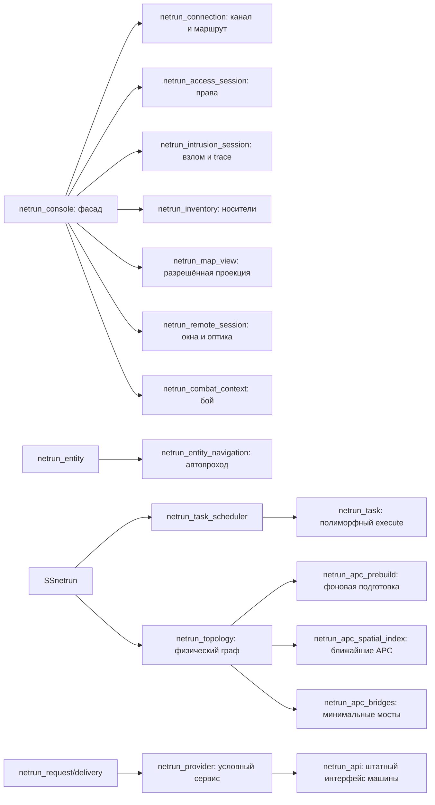

# Разработка и проверка нетрана

## Запуск игры

Нужны версии BYOND и Node.js из корневого `dependencies.sh` и штатные зависимости
сервера (включая rust-g). Используйте обычную сборку BlueMoon, а не тестовый DMB:

```powershell
# Из корня репозитория, Windows:
tools/build/build.bat
# Либо через установленный Node:
node tools/build/build.js build
```

Откройте `tgstation.dmb` в DreamDaemon и подключитесь клиентом BYOND. Штатная
сборка собирает TGUI вместе с DM. На Linux эквивалент — `tools/build/build`.
Для отдельной проверки DM без пересборки интерфейса: `node tools/build/build.js dm`.

На тестовой станции нужны работающий APC и питание устройств. Администратор
может создать `/obj/machinery/computer/netrun_terminal`, `/obj/item/netrun_deck`,
`/obj/item/netrun_shard`; для обычного получения есть исследования `netrunning`
и `netrunning_neural`. Деку откройте в руке или подключите к устройству рядом.
Локальная цепочка APC работает без NTnet; между секторами нужны настоящие
работающие `/obj/machinery/ntnet_relay` с обеих сторон.

Для атмосферных сервисов поставьте `/obj/machinery/airalarm`,
`/obj/machinery/atmospherics/components/binary/pump` или `volume_pump`.
На станции можно использовать уже существующие устройства. ID с
`ACCESS_ATMOSPHERICS` даёт обычные права управления; ключ ЛВС даёт только
обнаружение и переходы. Заблокированная сигнализация требует разблокировки на
месте либо ROOT-команды `atmos_lock`. На странице устройства показываются
условия, мешающие выполнить действие.

## Автоматические проверки

```powershell
node tools/netrun/run-tests.mjs --list
node tools/netrun/run-tests.mjs
node tools/netrun/run-tests.mjs --filter navigation
node tools/netrun/run-tests.mjs --frontend
node --test tools/netrun/run-tests.test.mjs
```

DM runner автоматически выбирает подключённые `netrun_*` тесты, собирает
изолированный профиль `hermetic`, запускает мир и проверяет свежий JSON-отчёт.
`FAIL`, `SKIPPED`, отсутствующий результат и пустая выборка являются ошибкой.
Не нужно менять `_compile_options.dm`, вписывать `TEST_FOCUS` или поддерживать
ручной список тестов. Детали, установка TGUI и `DM_EXE` описаны в
[инструкции runner](../../../../tools/netrun/README.md).

Дополнительные проверки интерфейса из `tgui/`:

```powershell
node .yarn/releases/yarn-4.15.0.cjs tsc --noEmit
node .yarn/releases/yarn-4.15.0.cjs eslint packages/tgui/interfaces/NetrunTerminal
node .yarn/releases/yarn-4.15.0.cjs run tgui:build
```

Логи DM находятся в `data/logs/ci-hermetic/`, выборка — в
`tmp/netrun-tests.txt`. Тестовый мир не заменяет интерактивный прогон на рабочей
карте и измерение нагрузки с несколькими игроками.

## Объекты и ответственность



Изменяемое состояние принадлежит одному объекту. Подсистема владеет очередями
и реестрами, сеанс — правами/взломом/инвентарём, пакет — своим таймером и
контекстом отправителя, навигация — маршрутом и таймером перехода. Общие
провайдеры не хранят данные конкретной машины или оператора.

| Файл | Ответственность |
|---|---|
| `core/task_scheduler.dm` | FIFO-очереди, coalescing, приоритеты, профили, подтипы задач |
| `core/subsystem.dm` | Постановка работы, реестры, обход активных объектов |
| `core/topology.dm` | Состав физического графа, привязки и публикация |
| `core/apc_spatial_index.dm` | Точный поиск соседей; прямой обход малых секторов |
| `core/apc_prebuild.dm` | Подготовка без публикации частичного графа |
| `core/apc_bridges.dm` | Общий для sync/background минимальный набор мостов |
| `core/routes.dm` | Деревья путей, стоимость и кеш физических маршрутов |
| `core/providers.dm`, `core/api.dm` | Контракт сервиса и адаптер штатного UI |
| `core/requests.dm` | Однократная доставка, зависимости, отмена, повторные проверки |
| `entity/navigation.dm` | Поиск разрешённого пути, отмена/замена маршрута и cooldown |
| `integration/atmospherics.dm` | Воздушная сигнализация и два вида насосов |

Расширяйте соответствующий контракт подтипом. Новому виду задачи нужен
`/datum/netrun_task` с уникальным `kind` и `execute(worker)`; менять switch
подсистемы не требуется. Новому игровому сервису нужен
`/datum/netrun_provider` или `/datum/netrun_api`; полный контракт и пример — в
[PROVIDERS.md](PROVIDERS.md). Новые файлы подключаются в `tgstation.dme`, тесты —
в `code/modules/unit_tests/_unit_tests.dm`. Константы, нужные тестам, помещаются
в `_DEFINES/netrun.dm`, который подключён до тестовых исходников.

Сигнальные обработчики отмечают изменения и ставят работу в очередь. Они не
строят граф, не сериализуют TGUI и не выполняют тяжёлые операции машины.
Для окончательной проверки действия используйте новый request-owned path tree;
разрешения из UI и заимствованная таблица маршрутов не являются авторизацией.

## Проверка игрового сценария перед релизом

1. Откройте терминал, найдите устройство, смените сектор/этаж, сузьте фильтры и
   выберите результат поиска. Узел должен стать виден, камера — перейти к нему.
2. Начните взлом закрытой ЛВС. Перейдите в файлы и карту: предупреждение об атаке
   остаётся доступным, ввод не теряет фокус. Отмена атаки убирает предупреждение.
3. Оставьте консоль бездействовать, затем начните новый взлом: старое время
   простоя не должно сразу увеличивать trace.
4. Сущностью начните автопроход, замените цель во время cooldown, отмените
   кнопкой и совершите ручной переход. Проверьте исчезновение цели из HUD.
5. Отключите APC/реле/целевой сервис после отправки запроса. Действие должно
   отмениться при доставке; восстановление устройства не переигрывает пакет.
6. Измените насос через физический интерфейс и проверьте состояние на карте;
   затем измените уставку через сеть. Проверьте ограничения прав, проводов и
   диапазона, работу штатной атмосферы и журнал расследований.
7. На большой карте проверьте drag/zoom, связи, пересекающие экран, несколько
   одновременных окон, закрытие/повторное открытие и восстановление map snapshot.

Счётчики планировщика и topology полезны для профилирования, но не являются
гарантией задержки: бюджет проверяется между операциями. Переходы фаз prebuild
могут включать создание индекса и сортировку. Для оценки нагрузки фиксируйте
карту, количество устройств/активных сеансов и версии компилятора/TGUI.
