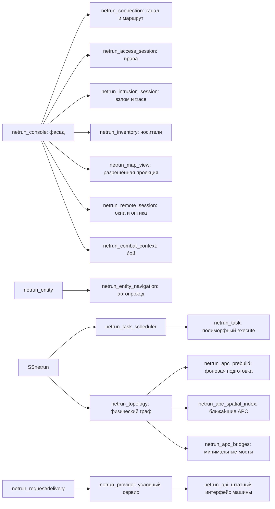

# Разработка и проверка нетрана

## Запуск игры

Нужны версии BYOND и Node.js из корневого `dependencies.sh` и штатные зависимости
сервера (включая rust-g). Используйте обычную сборку BlueMoon, а не тестовый DMB:

```powershell
# Из корня репозитория, Windows:
tools/build/build.bat
# Либо через установленный Node:
node tools/build/build.js build
```

Откройте `tgstation.dmb` в DreamDaemon и подключитесь клиентом BYOND. Штатная
сборка собирает TGUI вместе с DM. На Linux эквивалент — `tools/build/build`.
Для отдельной проверки DM без пересборки интерфейса: `node tools/build/build.js dm`.

На тестовой станции нужны работающий APC и питание устройств. Администратор
может создать `/obj/machinery/computer/netrun_terminal`, `/obj/item/netrun_deck`,
`/obj/item/netrun_shard`; для обычного получения есть исследования `netrunning`
и `netrunning_neural`. Деку откройте в руке или подключите к устройству рядом.
Локальная цепочка APC работает без NTnet; между секторами нужны настоящие
работающие `/obj/machinery/ntnet_relay` с обеих сторон.

Для атмосферных сервисов поставьте `/obj/machinery/airalarm`,
`/obj/machinery/atmospherics/components/binary/pump` или `volume_pump`.
На станции можно использовать уже существующие устройства. ID с
`ACCESS_ATMOSPHERICS` даёт обычные права управления; ключ ЛВС даёт только
обнаружение и переходы. Заблокированная сигнализация требует разблокировки на
месте либо ROOT-команды `atmos_lock`. На странице устройства показываются
условия, мешающие выполнить действие.

## Автоматические проверки

```powershell
node tools/netrun/run-tests.mjs --list
node tools/netrun/run-tests.mjs
node tools/netrun/run-tests.mjs --filter navigation
node tools/netrun/run-tests.mjs --frontend
node --test tools/netrun/run-tests.test.mjs
```

DM runner автоматически выбирает подключённые `netrun_*` тесты, собирает
изолированный профиль `hermetic`, запускает мир и проверяет свежий JSON-отчёт.
`FAIL`, `SKIPPED`, отсутствующий результат и пустая выборка являются ошибкой.
Не нужно менять `_compile_options.dm`, вписывать `TEST_FOCUS` или поддерживать
ручной список тестов. Детали, установка TGUI и `DM_EXE` описаны в
[инструкции runner](../../../../tools/netrun/README.md).

Дополнительные проверки интерфейса из `tgui/`:

```powershell
node .yarn/releases/yarn-4.15.0.cjs tsc --noEmit
node .yarn/releases/yarn-4.15.0.cjs eslint packages/tgui/interfaces/NetrunTerminal --ext .ts,.tsx
node .yarn/releases/yarn-4.15.0.cjs run tgui:build
```

Логи DM находятся в `data/logs/ci-hermetic/`, выборка — в
`tmp/netrun-tests.txt`. Тестовый мир не заменяет интерактивный прогон на рабочей
карте и измерение нагрузки с несколькими игроками.

## Объекты и ответственность



Изменяемое состояние принадлежит одному объекту. Подсистема владеет очередями
и реестрами, сеанс — правами/взломом/инвентарём, пакет — своим таймером и
контекстом отправителя, навигация — маршрутом и таймером перехода. Общие
провайдеры не хранят данные конкретной машины или оператора.

| Файл | Ответственность |
|---|---|
| `core/task_scheduler.dm` | FIFO-очереди, coalescing, приоритеты, профили, подтипы задач |
| `core/execution_limits.dm` | Публичные настройки подсистемы и нормализованный контракт лимитов |
| `core/interaction.dm` | Явный ввод игрока, приоритетная очередь и немедленный ответ UI |
| `core/subsystem.dm` | Постановка работы, реестры, обход активных объектов |
| `core/topology.dm` | Состав физического графа, привязки и публикация |
| `core/apc_spatial_index.dm` | Точный поиск соседей; прямой обход малых секторов |
| `core/apc_prebuild.dm` | Подготовка без публикации частичного графа |
| `core/apc_bridges.dm` | Общий для sync/background минимальный набор мостов |
| `core/routes.dm` | Деревья путей, стоимость и кеш физических маршрутов |
| `core/providers.dm`, `core/api.dm` | Контракт сервиса и адаптер штатного UI |
| `core/requests.dm` | Однократная доставка, зависимости, отмена, повторные проверки |
| `entity/navigation.dm` | Поиск разрешённого пути, отмена/замена маршрута и cooldown |
| `entity/reactions.dm` | Событийная реакция ICE и единственный отменяемый таймер боевого дедлайна |
| `integration/atmospherics.dm` | Воздушная сигнализация и два вида насосов |

Расширяйте соответствующий контракт подтипом. Новому виду задачи нужен
`/datum/netrun_task` с уникальным `kind` и `execute(worker, limits)`; менять switch
подсистемы не требуется. Новому игровому сервису нужен
`/datum/netrun_provider` или `/datum/netrun_api`; полный контракт и пример — в
[PROVIDERS.md](PROVIDERS.md). Новые файлы подключаются в `tgstation.dme`, тесты —
в `code/modules/unit_tests/_unit_tests.dm`. Константы, нужные тестам, помещаются
в `_DEFINES/netrun.dm`, который подключён до тестовых исходников.

Сигнальные обработчики отмечают изменения и ставят работу в очередь. Они не
строят граф, не сериализуют TGUI и не выполняют тяжёлые операции машины.
Для окончательной проверки действия используйте новый request-owned path tree;
разрешения из UI и заимствованная таблица маршрутов не являются авторизацией.

## Лимиты исполнения и отзывчивость

Значения по умолчанию объявлены как `NETRUN_DEFAULT_*` в `_DEFINES/netrun.dm`.
Администратор/код подсистемы меняет соответствующие поля `SSnetrun`;
`get_execution_limits(TRUE)` нормализует их перед следующим `fire()`.
Задачи получают один объект `netrun_execution_limits` и не читают произвольные
глобальные числовые константы внутри `execute`.

| Поля SSnetrun | Назначение и исходные значения |
|---|---|
| `task_adaptive_budget`, `task_budget_ms`, `task_min_budget_ms` | Адаптивный бюджет CPU, 2 / 0,30 мс |
| `task_pressure_tick_usage` | TICK_USAGE, при котором включается минимальный бюджет: 100 |
| `task_min_per_pass`, `task_max_per_pass` | Предел числа задач за один проход: 2 / 48 |
| `task_initial_cost_ms`, `task_cost_floor_ms`, `task_cost_smoothing` | Начальная оценка / нижняя оценка CPU и EMA: 0,1 / 0,05 мс / 0,15 |
| `task_population_interval` | Интервал обхода реестров: 1 секунда |
| `apc_prebuild_operations` | Максимум шагов фоновой подготовки APC: 96 |
| `task_priority_rotation` | Весовая последовательность CRITICAL / NORMAL / BACKGROUND |
| `task_critical_late_after`, `task_normal_late_after`, `task_background_late_after` | Пороги счётчиков опоздания: 2 / 5 / 20 секунд |
| `route_refresh_interval`, `route_expiry_interval` | Обновление / удаление таблиц маршрутов: 1 / 2 секунды |
| `ui_refresh_interval`, `ui_activity_lease`, `node_activity_duration` | Фоновое обновление UI / активный сеанс / подсветка узла: 1 / 3 / 5 секунд |
| `task_interactive_priority`, `task_interactive_burst`, `ui_interactive_flush` | Класс явного ввода, максимум подряд перед обычной задачей, немедленный ответ: CRITICAL / 8 / TRUE |

Отрицательные, бесконечные и ошибочные значения не создают бесконечный цикл.
Число задач, шаги prebuild и интервалы ограничены; `min` не превышает `max`.
Ошибочная весовая последовательность дополняется недостающими классами, чтобы
фоновая работа сохраняла возможность исполнения.

`note_ui_activity()` подтверждает активность открытого UI. `note_user_action()` означает
явное действие и сразу ставит объединяемую задачу в отдельную входную очередь.
Обе очереди подчиняются общему CPU-бюджету и максимуму задач. После ограниченной
серии ввода обслуживается одна обычная задача. `finish_user_action(node)` обновляет
состояние затронутой машины и отправляет UI без секундного ожидания; защита от
повторного входа сохраняется. Доставка пакета по-прежнему ждёт сетевую задержку
и повторно проверяет оператора, маршрут, права и cooldown.

Ответ `input_ack` повторяет только короткий текстовый `_netrun_action` после
обычной проверки допуска TGUI. Он означает обработку ввода сервером, включая
отказ по игровым условиям. Успех команды определяется её результатом и состоянием.

Открытая консоль держит лёгкие подписки независимо от выбранной страницы:
изменения выбранного устройства, закреплённых окон, маршрута, удалённого диска,
журнала ЛВС и чата помечают UI грязным. `invalidate_ui()` сразу ставит одну
объединяемую задачу в обычную очередь, не ожидая секундного `populate_tasks()`.
Сигнальный обработчик не строит граф и не отправляет JSON. Очередь остаётся
под общим CPU-бюджетом; явный ввод сохраняет отдельную приоритетную очередь.
Штатный auto-update отключён и у терминала, и у программы NTOS.

Холодный узел обрабатывает обычные сигналы не чаще раза в 10 секунд после
**завершённой обработки** (`last_processed_at`). Новые сигналы объединяют флаги,
но не сдвигают уже назначенный срок: постоянный поток не откладывает последнюю
пачку навсегда. До этого срока новая node task не создаётся. Глобальный поток
`COMSIG_NETRUN_NODE_CHANGED` для карт и консолей отправляет одну пачку; локальный
сигнал самого узла и реальные игровые поля остаются актуальными.

Исключения — изменение привязки/удаление, доступность маршрута и истечение
таймера. Они не ждут холодного интервала. Выбранное устройство, источник,
закреплённое активное окно, ближайшие устройства в 7 тайлах и конкретные пути
к цели/пеленгу получают короткую lease до 3 секунд и быстрый fallback раз в
секунду. Только активный UI или игрок/тело погружения продлевает интерес;
движение автономного ICE не делает весь отдел горячим. Ping и пакеты продлевают
интерес только к своим сохранённым hops; второе дерево маршрутов не строится.
После потери интереса тихие legacy-узлы сверяются раз в 30 секунд.

Параметры подсистемы: `node_update_interval` (10 секунд), `node_poll_interval`
(1 секунда), `node_idle_poll_interval` (30 секунд). Команды и доставка пакетов
по-прежнему проверяют реальное состояние и свежий маршрут независимо от
периодичности представления.

Тяжёлая подписка проекции принадлежит только видимой карте. Скрытая карта
не копит адреса изменённых узлов. Контекстные подписки отслеживают открытых
зрителей, экипировку и цепочку контейнеров переносной консоли; смена оператора
обновляет слушатели. Закрытие окна последнего оператора не останавливает
обновления остальных зрителей. После закрытия UI и истечения activity lease
слушатели снимаются, а удаление консоли отменяет её ожидающую задачу.

Оставлена ограниченная сверка полей, которые старый код меняет прямой записью:
списка ID-доступов зрителей, переключателей NTnet и `netrun_status()` одного
видимого устройства (например, заряда APC). Сверка не сериализует тихую панель.
Обратные отсчёты, асинхронные страницы NTnet и
штатные окна с непрерывными данными по-прежнему получают периодические снимки.
Новые провайдеры должны публиковать `state_signals`, а изменения дисков — идти
через `netrun_file_store`, чтобы доставка была событийной.

При входе сущности, начале взлома и применении боевой программы просыпаются
затронутые ICE. Их задачи объединяются; спящие патрули остаются в обычной очереди.
Активный каст держит один отменяемый таймер дедлайна. Повторный wake не продвигает
`world.time`, не уменьшает cooldown и не сокращает телеграф атаки (минимум 2 секунды).
При отладке сравнивайте `WaitMax`/`Late`, `Ovr` и `Done` в статусе подсистемы;
`profile_summary()` планировщика показывает CPU и ожидание по видам работ.

## Проверка игрового сценария перед релизом

1. Откройте терминал, найдите устройство, смените сектор/этаж, сузьте фильтры и
   выберите результат поиска. Узел должен стать виден, камера — перейти к нему.
2. Начните взлом закрытой ЛВС. Перейдите в файлы и карту: предупреждение об атаке
   остаётся доступным, ввод не теряет фокус. Отмена атаки убирает предупреждение.
3. Оставьте консоль бездействовать, затем начните новый взлом: старое время
   простоя не должно сразу увеличивать trace.
4. Сущностью начните автопроход, замените цель во время cooldown, отмените
   кнопкой и совершите ручной переход. Проверьте исчезновение цели из HUD.
5. Отключите APC/реле/целевой сервис после отправки запроса. Действие должно
   отмениться при доставке; восстановление устройства не переигрывает пакет.
6. Измените насос через физический интерфейс и проверьте состояние на карте;
   затем измените уставку через сеть. Проверьте ограничения прав, проводов и
   диапазона, работу штатной атмосферы и журнал расследований.
7. На большой карте проверьте drag/zoom, связи, пересекающие экран, несколько
   одновременных окон, закрытие/повторное открытие и восстановление map snapshot.

Счётчики планировщика и topology полезны для профилирования, но не являются
гарантией задержки: бюджет проверяется между операциями. Переходы фаз prebuild
могут включать создание индекса и сортировку. Для оценки нагрузки фиксируйте
карту, количество устройств/активных сеансов и версии компилятора/TGUI.

## Межмашинный транспорт и DNS

`core/machine_transport.dm` задаёт контракт `netrun_machine_service` и
`netrun_machine_message`. Атом публикует типы своих служб через
`netrun_machine_service_types()`, а компонент узла регистрирует их жизненный
цикл. Служба отвечает за `matches()`, `accepts()` и `receive()`; транспорт
отвечает только за обнаружение, физический путь, задержку и отмену.
`service_tag()` — логический адрес службы, `service_key()` — ключ регистрации.

`send(service_id, message, recipient_tag)` принимает владение сообщением и
возвращает факт постановки в очередь. Получение подтверждается отдельно.
Первый вызов отправляет DNS-запрос и ответ через физический сервер, затем
пакет данных. Ответы кэшируются на 30 секунд (пустые — на 2 секунды), отдельно
по типу службы и тегу; появление другого типа службы кэш не сбрасывает.
`send()` рассылает пакет всем подходящим службам: адаптер одиночной команды
обязан выбрать конкретный тег/одного получателя. `send_to()` предназначен для
ответов и уже обнаруженных собеседников.

И оригинал, и копии сообщений освобождает транспорт. Подтип с принадлежащим
ему datum должен переопределить `copy()`/`Destroy()`; его `New()` допускает
вызов без аргументов. `user_ref` несёт происхождение действия, но не заменяет
повторную проверку штатных прав при получении. Удаление машины отменяет её
пакеты. Разрыв сети не запускает прямой вызов получателя в обход транспорта.

Ограничения: 64 ожидающих обнаружения на службу, 64 сообщения на запрос,
2048 пакетов одновременно, 4096 сообщений в общей очереди DNS и 128 записей
DNS-кэша на службу. Повторный status атмосферы заменяет ожидающий снимок;
команды и сообщения пользователей сохраняются по отдельности. При временно
отсутствующем DNS выполняется до пяти попыток с интервалом 2 секунды; пакет
данных не переигрывается после ошибки. Деревья маршрутов разделяются по
физическому APC и хранятся в отдельном кэше на 64 источника. Каждое ребро
проверяется при отправке и доставке. Только пакеты с реальным игроком
поддерживают быстрый режим обновления своего маршрута.

DNS — `/obj/machinery/netrun_server/dns`, с обычными питанием и компонентами
сборки. Если на станции его нет, сервер появляется в серверной при старте
раунда; плату также можно исследовать и напечатать. Регистрация метаданных
служб локальная; обнаружение и доставка требуют доступного физического пути.
На карте Pixi реальные доставки показаны зелёными импульсами, DNS — синими;
визуализация ограничена 20 событиями в секунду и одним событием на пару в
секунду независимо от пропускной способности транспорта.

Адаптеры охватывают атмосферику и сигнализации, камеры, НИО/производство/мехфаб,
коммуникационные консоли, PDA и telecomms. Штатная отдельная radio-цепочка
контроллера шлюза мусоросжигателя (дверь, датчик давления, DP pump) сохраняется.

## Пакеты PDA и telecomms

`machine_telecomms.dm` сохраняет штатные `links`, фильтры типа, частоты и
ограничения этажей. `relay_information()` возвращает число принятых транспортом
пакетов: это выбирает штатный hub/bus fallback, но не означает доставку.
Вызвать `receive_information()` другой машины вправе только принявший пакет
сервис. Разрыв связи, выключение и удаление машины проверяются при доставке.
Глубина relay переносится в копию сигнала, поэтому асинхронный цикл не сбрасывает
штатный предел 48 переходов.

Перед отправкой broadcaster hub запрашивает уровни своих relays и ждёт
возвратные пакеты. Этот этап заменяет прежнее синхронное изменение общего
`signal.levels`: копии сигналов не теряют межэтажное покрытие. Радио с физическим
RF-резервом ждёт завершения принятой telecomms-транзакции перед резервной
передачей, чтобы две асинхронные доставки не дублировали речь.

Каждый `netrun_machine_message/telecomms` владеет снимком сигнала и его списков.
Общий `netrun_telecomms_transmission` считает ожидающие ветви; DNS fanout сначала
удерживает копии, затем освобождает оригинал. Само освобождение сообщения не
является ошибкой: отмена проходит через `failed(reason)`. Финальная доставка
дедуплицируется по реальному экземпляру messenger-программы.

PDA проходит полный путь устройство → приёмник → штатные telecomms-машины →
передатчик → устройство адресата. Передатчик не доставляет сообщение глобальным
вызовом программы. Штатный сервер продолжает перехватывать и журналировать
сообщения, а rigged-сообщения сохраняют свой маршрут и обработку. `signal.done`
для PDA выставляется после фактического получения программой. Пока ветви
ожидают DNS или сеть, интерфейс показывает ожидание; при отказе — причину.
Исходящая запись чата, подтверждение отправителя, журнал и cooldown появляются
после получения. Частичная массовая доставка сохраняет записи только у
получивших адресатов и показывает число доставок.

Адрес PDA-сервиса — REF установленной messenger-программы, а физический путь
принадлежит узлу устройства. Виртуальный PDA сущности использует
`entity.host_node` как proxy; его собственный узел не создаётся. При перемещении
сущности endpoint обновляет proxy перед проверкой маршрута. Автоматические
уведомления факса, штрафов и headhunt, а также консоль мониторинга сообщений
проходят тот же транспорт. Логического обхода сети для них нет. Физическое RF
вещание радио остаётся отдельным штатным каналом.
